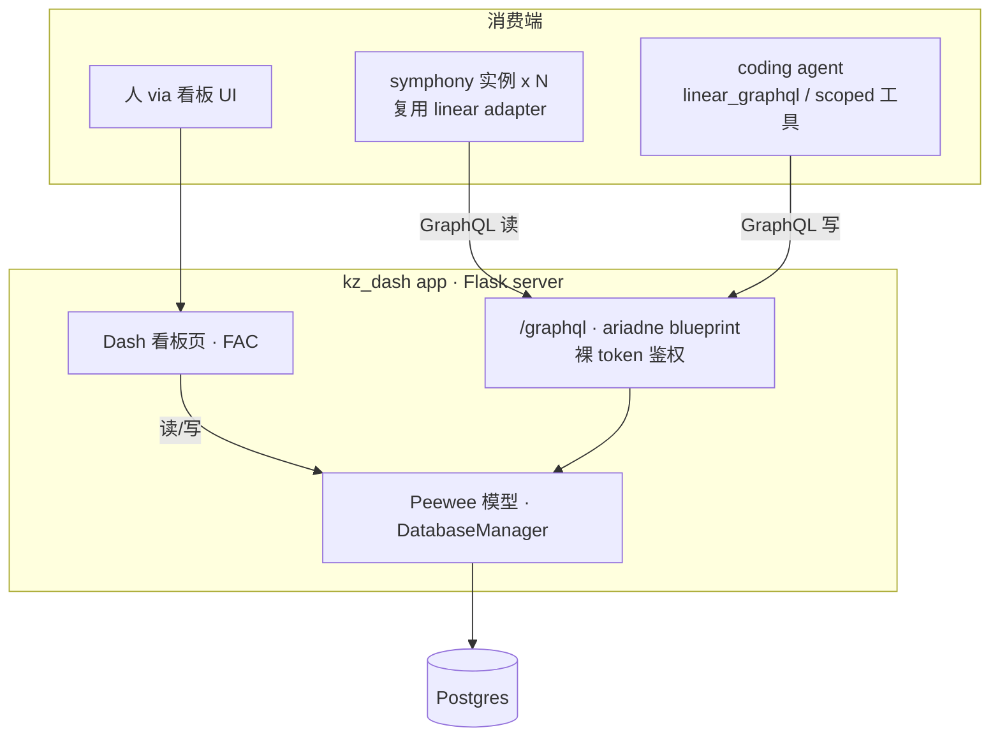
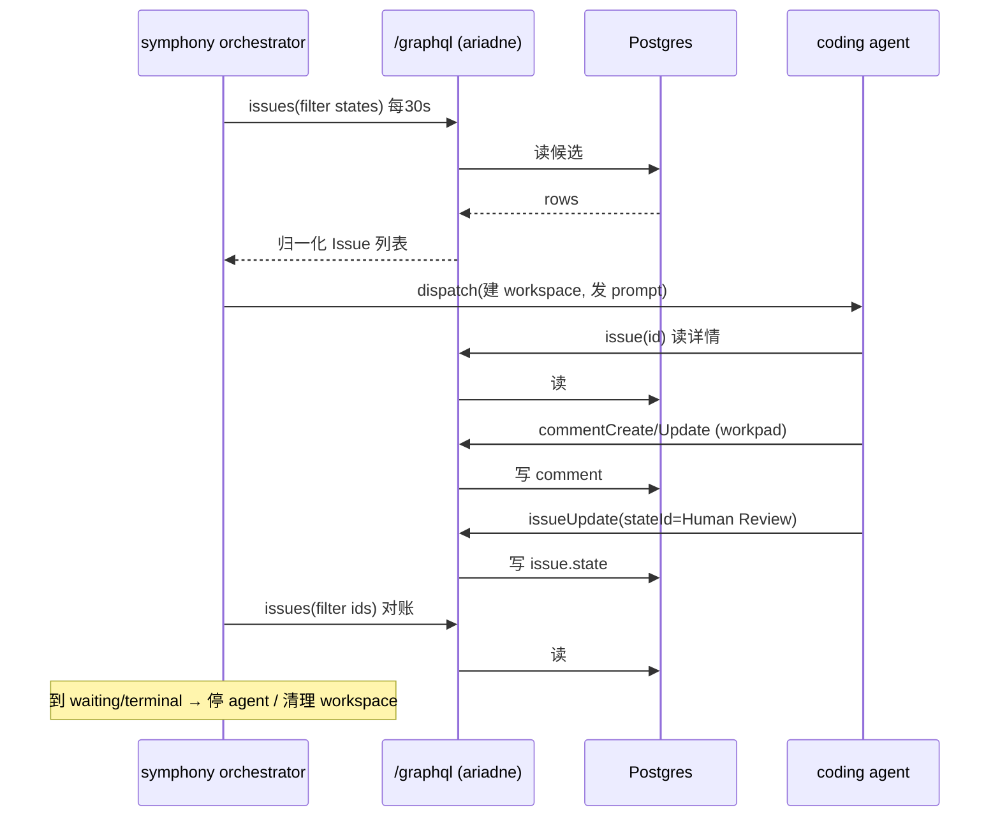
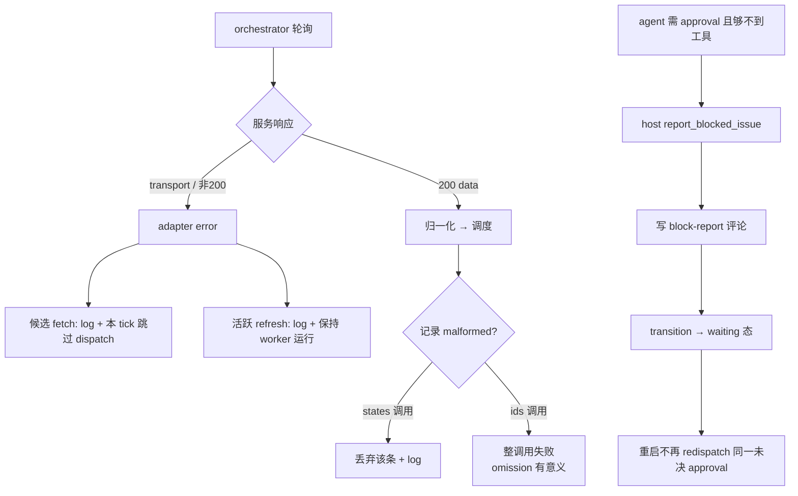

# Linear 兼容 Tracker — 需求与技术框架

> 状态:框架稿 v0.1(待评审深化)。本文锁定**需求边界**与**技术框架**;精确 SDL、resolver、迁移、看板交互留待深化稿。
> 文档随 symphony initiative 存于本仓库;实现落主仓 kz_dash(Dash/Flask/Peewee),文中 `source/` 等路径均指主仓。

## 1. 背景与目标

### 1.1 背景(为什么做)
symphony 是 issue tracker 的**消费端**(轮询 + 派 coding agent 干活),本身不存 issue。当前用 Linear 作 tracker,存在结构性限流:

- Linear 按 API key 每小时计**请求数 + 查询复杂度**双配额。
- symphony 默认 **30s 轮询**(`polling.interval_ms`),每 tick 打带 `inverseRelations`/`comments` 的复杂 GraphQL。
- 单 workflow 只认一个 `project_slug` → **多项目 = 多 symphony 实例共用一个 key**,负载线性叠加;再叠加每个 agent 的 workpad/transition 工具调用。
- 多项目一起跑必然触发限流。

### 1.2 目标
自建一个 **Linear-API 兼容**的 tracker 后端,去掉 symphony 对 Linear SaaS 的依赖:

- **主因**:消除外部小时配额。同样的轮询/改动落到自己的库是带索引的廉价查询,一个服务可同时喂 N 个 symphony 实例。
- **次因**:看板 UI 定制化显示。
- **约束**:尽量不动 symphony —— 只切 `tracker.provider.endpoint`,复用现有 `linear` adapter,**零新增 Elixir**。

## 2. 需求概览

| # | 需求 | 说明 | 优先级 |
|---|------|------|--------|
| R1 | Linear 兼容 GraphQL 服务 | symphony 与 agent 通过它读 issue、写 workpad/状态;drop-in 替换 Linear | P0 |
| R2 | 看板 UI(dash 栈) | Dash + FAC 页面,按状态分列管理 issue | P1(次因) |
| R3 | 多项目无外部限流 | 一服务多实例,自有库无小时配额;并发写安全 | P0 |
| R4 | symphony 零改 | 仅 endpoint/api_key/project_slug 配置切换 | P0 |

**非目标(本期不做)**:完整 Linear 产品(cycle/roadmap/estimate/移动端/丰富集成);通用 tracker CRUD 对齐各家(SPEC §11 明确反对);symphony 编排器/后端改动。

## 3. 技术框架

### 3.1 选型
- **语言/运行时**:Python,复用 kz_dash(Magic Dash Pro)kit。
- **Web 底层**:Flask(Dash 的底层 server)。
- **GraphQL**:**ariadne**(schema-first)。理由:任务是复刻已存在的 Linear schema 子集,SDL 可逐字对齐 Linear 形状;解析/校验/执行/**内省**由底层 `graphql-core` 提供;本服务是 I/O bound,瓶颈在 DB 不在 GraphQL 解析。挂载为 Flask blueprint,与现有 Flask-RESTx 命名空间共存。(strawberry code-first 为备选,深化时定。)
- **ORM/存储**:Peewee(kz_dash `BaseModel` + Singleton `DatabaseManager` + `peewee_migrate`)。**默认 Postgres**(多实例并发写);低并发可 SQLite WAL(`DatabaseManager` 已支持)。
- **看板前端**:Dash + FAC(feffery-antd-components),页面提供 `layout()`,回调单向数据流,遵循主仓 `docs/Dash与fac组件开发规范.md`。
- **鉴权**:`/graphql` 路由用**裸 `Authorization: <token>`** 校验(symphony 发的就是裸 key,无 Bearer),独立于 Flask-Login session。

### 3.2 架构与模块归属
一个 app(kz_dash kit 装配)承载三个面,共用同一套 Peewee 模型与库:



模块归属(遵循主仓 kz_dash kit 约定,下列路径均为主仓):
- GraphQL schema/resolver → 后端模块(`source/backend/modules/` 风格),挂 Flask blueprint。
- 数据模型 → `source/models/`,继承 `BaseModel`,`peewee_migrate` 迁移。
- 看板页 → `source/pages/`,`layout()` + FAC 组件 + 回调。
- app 装配/`configs/` → 深化时定(新目录 or 复用脚手架)。

## 4. GraphQL 兼容契约(子集)

symphony 实际依赖面(证据:本仓库 `elixir/lib/symphony_elixir/linear/client.ex`、`linear/agent_tool.ex`、`.codex/skills/linear/SKILL.md`)。**精确 SDL 深化时钉死**,此处锁范围。

### 4.1 Queries
- `issues(filter:{project:{slugId:{eq}}, state:{name:{in}}}, first, after)` 与 `issues(filter:{id:{in}, project:{slugId:{eq}}}, first)`
  → `nodes{ id identifier title description priority state{name} branchName url assignee{id} labels{nodes{name}} inverseRelations(first){nodes{type issue{id identifier state{name}}}} createdAt updatedAt }` + `pageInfo{hasNextPage endCursor}`
- `issue(id)` → `{ id identifier title url state{name type} labels{nodes{name}} project{id name} team{id key} comments(first:100){nodes{id body createdAt updatedAt resolvedAt user{name}}} }`
- `viewer{ id }`(`assignee: me` 路由用)
- `workflowStates(filter:{name:{eq}}, first:50){ nodes{id name team{id}} }`
- 内省 `__type` / `__schema`(graphql-core 自带;skill 已预置操作形状,不再依赖内省)
- skill 另按 key/identifier 查 issue,形状已钉:`issue(id: <key>)` 与 `issues(filter:{id:{eq}})`(IssueIDComparator 兼收 UUID/identifier)

### 4.2 Mutations
**MVP 必需**
- `commentCreate(input:{issueId body}){ success comment{id body updatedAt} }`
- `commentUpdate(id, input:{body}){ success comment{id updatedAt} }`
- `issueUpdate(id, input:{stateId}){ success issue{id identifier state{name}} }`

**二期(仅当 workflow 用到)**:`attachmentLinkURL` / `attachmentLinkGitHubPR`、`uploadFile`(Linear 多步上传,自 host 可简化)、`projects(filter:{slugId:{eq}})` / `issueCreate` / `issueRelationCreate`(skill 预置的 follow-up issue 形状,WORKFLOW.md 范围外改进流程用)。

### 4.3 信封 / 鉴权 / 分页
- HTTP 200 + `{data}` / `{errors}`;`Content-Type: application/json`。
- `Authorization: <裸 token>`(无 Bearer)。
- 分页 `pageInfo{hasNextPage endCursor}`,adapter 跟随 cursor;页大小 50。
- 字段类型:`priority` int、时间 RFC3339、`state{name,type}`、labels 小写由 adapter 处理。

### 4.4 drop-in 依据
- symphony `linear` adapter 的 endpoint 校验**仅查非空字符串、不强制 https**(`linear/adapter.ex`),指向 `http://本地:端口/graphql` 放行。
- 鉴权头为裸 key(`linear/client.ex` `graphql_headers`)。
- 故复用 `linear` adapter、仅改配置即可,无需新增 Elixir。

## 5. 数据模型(草图)

表少、最新行即当前态、位置派生不存、不预留无来源字段。约 7 表,均继承 `BaseModel`(created_at/updated_at/state 软删):

| 表 | 关键字段 | 备注 |
|----|----------|------|
| `issue` | id, identifier(如 KZ-12), project, team, title, description, state, priority(int), branch_name, url, assignee, labels(text[]) | 最新行即当前态 |
| `workflow_state` | id, team, name, type(active/waiting/terminal) | 每 team 一套;含自定义 waiting 态 |
| `comment` | id, issue, body, user, resolved_at | **workpad = 一条 comment** |
| `issue_relation` | id, type(blocks/…), issue, related_issue | blockers 取反向 |
| `project` | id, slug_id, name, team | symphony scope 用 slug_id |
| `team` | id, key, name | |
| `user` + `api_key` | id, name / token_hash, user | viewer 与鉴权 |

语义要点:
- **workpad**:body 以 `## Codex 工作台` / `## Codex Workpad` 开头、`resolved_at=null` 即 active;block-report 段的保留逻辑在 symphony host 侧(Elixir),服务只需 comment CRUD + `resolved_at`。
- **blockers**:`issue_relation` type=blocks 的反向。
- **dispatchable**(adapter 派生,不存):Todo + 无未终态 blocker + assignee 匹配(若配置)。
- 状态集(可配):active `Todo/In Progress`;waiting `Human Review/Rework/Merging`;terminal `Done/Closed/Cancelled/Duplicate`。

## 6. 读写端点与流程

### 6.1 读写端点
持久化数据全部落 Postgres,经 Peewee 模型。

**写点**
- agent → `commentCreate`/`commentUpdate`(workpad)、`issueUpdate(stateId)`(状态流转):每 turn 按需。
- symphony host → `report_blocked_issue`:写 block-report 评论 + transition 到 waiting 态(agent 够不到工具时的兜底)。
- 看板 UI → 建 issue / 改状态(拖拽)/ 评论:人工操作时。

**读点**
- symphony orchestrator → `issues(filter states)` 每 30s 轮询候选;`issues(filter ids)` 对账活跃 run;启动时 terminal 态清理。
- agent → `issue(id)` 读详情 + comments。
- 看板 UI → 读同库渲染。

### 6.2 正常闭环



### 6.3 例外路径



## 7. symphony 接入(唯一改动 = 配置)

```yaml
tracker:
  kind: linear
  provider:
    endpoint: http://127.0.0.1:8000/graphql   # 指向本服务
    api_key: $KZTRACKER_API_KEY                # 服务自签 token
    project_slug: "proj-a"                      # 本库 project.slug_id
    assignee: me                                # 可选,需 viewer{id}
```

多项目:每项目一个 WORKFLOW.md / symphony 实例,`project_slug` 各异,**共用同一服务与库**。

## 8. 分期落地(骨架 → 契约 → 最短闭环)

- **P0 骨架**:Flask + ariadne `/graphql` + 内省 + 裸 token 鉴权 + 种子(team/project/states + 1 issue)。
- **P1 契约**:实现 §4 MVP queries/mutations 的精确字段形状(SDL 钉死)。
- **P2 闭环**:一个 WORKFLOW.md 指向服务,跑通 轮询 → dispatch → agent 读 issue / upsert workpad / transition → Human Review。
- **P3 多项目**:N 实例 → 一服务,验证无配额;Postgres 并发写加行锁 / 幂等。
- **P4 看板**:Dash + FAC issue board UI。
- **P5**:附件 / upload(若需要)+ 硬化。

## 9. 边界与风险

- filter 嵌套输入形状(`project.slugId.eq` / `state.name.in` / `id.in`)必须逐字匹配 —— 模拟最 fiddly 处。
- 内省由 graphql-core 免费提供,保留即可;skill 已预置全部操作形状,不依赖内省。
- 字段类型 / 分页 cursor 需要正确,adapter 跟随 cursor。
- 并发写:多 agent 同时 `issueUpdate` / workpad upsert → 行锁 / 幂等。
- 纪律:只实现读核 + 这几个 mutation,**不建全 Linear schema**(SPEC §11)。

## 10. 待深化(评审后展开)

- GraphQL 框架最终定:ariadne vs strawberry。
- app 装配位置与 `configs/`(新目录 or 复用脚手架)、`kz_dash` 包路径映射。
- DB 定:Postgres vs SQLite WAL(并发评估)。
- 精确 SDL(types / inputs / 错误 category 映射)、resolver → Peewee 查询。
- 看板交互(拖拽改状态、列定义、实时刷新策略)。
- api_key 签发 / 权限 / 多项目 scope 隔离。