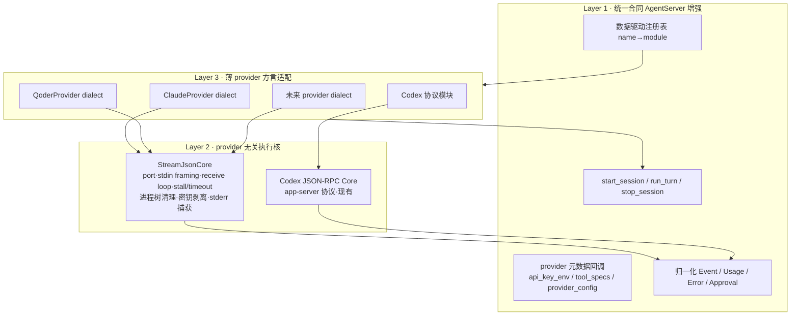

# 多 provider 后端扩展设计 Sketch

> 状态:设计 sketch v0.2(待评审深化,2026-11-26)。范围:**kingzeus/symphony fork** 的执行后端扩展。
> 核心方向(操作者定):**先抽象一个 provider 无关的通用层**,后续加 provider 是薄适配,不推倒重来。首批 provider = **Qoder CLI**。
> 参考:Multica(`multica-ai/multica`)Backend 抽象;philipdaquin/symphony-claude 的 Agent.Behaviour;Swiftyos/OpenSymphony 的多后端路由。
> 关联:[Symphony与Multica视角差异](../../docs/Symphony与Multica视角差异.md)、[symphony-fork功能合并todolist](symphony-fork功能合并todolist.md)、[Linear兼容tracker需求与技术框架](Linear兼容tracker需求与技术框架.md)。

## 1. 背景与目标

- 现状:fork 已有 **AgentServer 共享合同** + 两个深度后端(Codex.AppServer / ClaudeCodeBackend)。`--resume` 续会话、进程树清理、密钥剥离、类型化错误、受限 Linear MCP 已领先对比过的 fork。
- 诉求:参考 Multica 支持更多 provider,**首批 Qoder CLI**;且**以后会持续加 provider**,所以先抽象通用层,加 provider 不推倒重来。
- 约束(沿用 todolist):**不偏离上游形状**——不重写、不引入 Multica 的持久 agent 实体。worker 仍是 **session**(任务来 spawn、干完即弃),provider 只是「选哪套 backend/model/effort 配置 spawn 这次会话」的选择键。
- 非目标:Multica 的工人实体(在线状态/成功率/权限/squads)、看板 observability、聊天触发。

## 2. 核心发现:Symphony 已有 Multica 式 keystone 抽象

Multica 支持 11 个 CLI 的支点是「一个接口 + 每 CLI 一个实现 + 工厂注册」,**Symphony 的 AgentServer 合同与之同构**:

| 概念 | Multica(Go) | Symphony(Elixir) |
|---|---|---|
| 后端接口 | `Backend.Execute(ctx, prompt, opts) → Session` | `@callback start_session/2 · run_turn/4 · stop_session/1` |
| 流式消息 | `Session.Messages chan Message` | `AgentServer.Event`(progress/tool_activity/turn_completed/…) |
| 终态结果 | `Session.Result chan Result` | `run_turn` 返回 `{:ok, %{result, usage, session_id, payload}}` / `{:error, Error}` |
| 用量 | `Result.Usage map[model]TokenUsage` | `AgentServer.Usage` |
| 错误分类 | `Result.Status` | `AgentServer.Error`(kind/retryable?/blocked?) |
| 审批 | issue/comment 层 | `AgentServer.Approval` + 受限 MCP + host blocked-report |
| 工厂 | `agent.New(name, cfg)` switch | `AgentServer.backend_module/1`(目前硬编码 2 个) |
| 原生配置注入 | CLAUDE.md/AGENTS.md/GEMINI.md + 原生 skills 目录 | WORKFLOW.md prompt + `.codex/skills` |
| resume | ResumeSessionID + pinning + fallback | ClaudeCodeBackend `--resume`/`--session-id` |

**结论:加 provider 不是重构,是沿现有合同加后端 + 注册 + config。** 缺的不是接口,是「provider 无关的执行核」与「数据驱动注册表」。

## 3. Fork 实证:谁做过通用层,借什么避什么

| Fork | 抽象形状 | 借 | 避 |
|---|---|---|---|
| **philipdaquin/symphony-claude** | `Agent.Behaviour`(6 回调)+ 统一 `Agent.Event` + `Agent` 工厂(`@adapters` map)+ 4 adapter(claude/codex/minimax/opencode) | 回调集(尤其 `list_tools`/`adapter_config`/`api_key_env` 三个 provider 元数据回调);数据驱动工厂;统一 Event | **另立竞争合同**(与 AgentServer 并行);**每 adapter 从零重实现执行循环**,丢掉原后端深度(无 resume/进程树/密钥剥离);rate_limits 形状错(requests/tokens,已 P1-1 实证纠正) |
| **Swiftyos/OpenSymphony** | 平行 `codex/app_server.ex` + `claude_code/app_server.ex` + `agent_route.ex`(label→后端) | label 路由片(P2-1);per-provider 模块独立 | 无统一执行核,平行模块重复;205 commits 绑多后端架构,整体不合并 |
| **Multica** | 一个 `Backend` 接口 + 统一 message taxonomy + 每 CLI 薄实现 + 工厂 + 原生配置注入 + 版本门 + stderr_tail | keystone 接口;统一消息分类;原生配置注入;`CheckMinVersion` 版本门;bounded stderr 诊断 | 工人实体模型;浅层 exec+parse(审批在 issue 层,丢协议级控制) |

**两条核心教训**(直接定通用层建法):
1. **扩展 AgentServer,不另立合同。** philipdaquin 的 Behaviour 与 AgentServer 竞争是它被否的根因。通用层 = AgentServer 增强,不是新 Behaviour。
2. **通用层靠「抽取现有深度」建成,不靠「新写平行 adapter」。** philipdaquin 每 adapter 重写循环丢了 resume/进程树。正确做法:把 ClaudeCodeBackend 已积累的执行核抽成共享层,provider 做薄方言适配——深度保留,新增便宜。

## 4. 核心决策:深度 vs 广度

| 形状 | 得 | 失 |
|---|---|---|
| **逐个深度后端 + 共享核**(推荐) | 保留 resume/进程树/密钥剥离/类型化错误/受限 MCP;加 provider 薄适配;与现有两后端同构 | 首个共享核抽取是实打实工作量 |
| 通用浅层适配器(Multica 广度) | 一个可配置后端快速接任意 CLI | 退回 prompt+CLI 浅驱动,丢协议级控制;与 fork 优势相悖 |

**推荐深度 + 共享核**。操作者要的是执行质量(续会话/失败语义/审批控制),不是 CLI 数量;Qoder 接口与 Claude 近乎同构(§7),深度可达。浅层适配器留作未来接冷门 CLI 的可选补充,不在首批。

## 5. 通用层设计(三层)

### Layer 1:统一合同(扩展 AgentServer,不另立)

- 保留 `start_session/2 · run_turn/4 · stop_session/1` 与归一化 `Event/Usage/Error/Approval`(已比 philipdaquin 的 Event  richer:有 Approval、cache token、rate_limits)。
- 增 provider 元数据回调(借 philipdaquin,使通用层自描述):
  - `api_key_env() :: String.t()` — 密钥剥离名单按 provider 取。
  - `tool_specs() :: [map()]` — 动态工具 / 受限 MCP 工具广告。
  - `provider_config(settings) :: map()` — 从总 config 抽本 provider 配置。
- 注册表数据驱动(借 philipdaquin 工厂 + Multica `New`):`@backends %{atom_name => module}`(atom 键,保 `Event.backend` atom 类型,不做 atom→string 大扫荡),`backend_module/1` 查表、`backend_name/1` 反查、`backend_names/0` 列举。`backend_module` 未知**名字**显式 `ArgumentError`;`backend_name` 未知**模块**保留 `:codex` 兜底——runner 经 `opts[:backend_module]` 接受自定义模块(测试 FakeBackend 依赖此兜底),去掉会破坏行为。

### Layer 2:provider 无关执行核(两个协议族)

- **StreamJsonCore**(新,从 ClaudeCodeBackend 抽取):port spawn、stdin prompt framing(0600 临时文件)、行-delimited JSON receive 循环、stall/turn timeout、进程树清理(pgrep/ps 双 fallback)、密钥剥离、stderr 0600 捕获、usage/result 提取骨架。**provider 差异参数化**为一个 `Dialect`:
  - flag 构造(`--print`/`--output-format`/`--permission-mode`/`--mcp-config`/`--resume`…)
  - 权限值映射(camelCase↔snake_case)
  - 事件类型映射(CLI 方言 → 归一化 Event.type)
  - result/usage 字段路径(session_id/usage/is_error/subtype/permission_denials)
  - 原生指令文件名(CLAUDE.md / AGENTS.md)、skills 目录、api_key_env
- **Codex JSON-RPC Core**(现有 Codex.AppServer):app-server 协议不同(JSON-RPC 非 stream-json),保留独立核,但实现同一 Layer 1 合同。
- 两核都 emit 归一化 `AgentServer.Event` → orchestrator/runner 统一消费,与 provider 无关。

### Layer 3:薄 provider 方言适配

- **ClaudeProvider**:现 ClaudeCodeBackend 逻辑迁为 StreamJsonCore 上的 dialect,**深度保留**(行为不变重构)。
- **QoderProvider**:StreamJsonCore 上的 dialect,flag/权限/事件映射见 §7。
- **未来 provider**:加一个 dialect 模块 + 注册表项 + config schema即可。若某 provider 协议非 stream-json(如 ACP),则走独立核(如 Codex),仍实现 Layer 1 合同。

### 新 provider 落点:协议族决定

三层不是三选一,是一个栈:**Layer 1/2 是一次性地基,Layer 3 是每个新 provider 的边际工作**。接新 provider 优先落 Layer 3,但前提看其**协议族**:

| 新 provider 协议 | 落点 | 工作量 | 例子 |
|---|---|---|---|
| **stream-json CLI 族** | 纯 Layer 3:一个 Dialect over 现有 StreamJsonCore | 最便宜 | Qoder、opencode、minimax |
| **异协议**(JSON-RPC / ACP) | Layer 2 新核(或复用同协议核)+ Layer 3 适配 | 重 | Codex(app-server)、Zed 系(ACP) |

stream-json 族接一个新 provider,实际只动:
- 加一个 Dialect 模块(Layer 3):flag 构造、权限值映射、事件方言→归一化 Event、result/usage 字段路径、原生指令文件名/skills 目录/api_key_env。
- 注册表加一行(Layer 1)。
- config 加一个 embedded schema(Layer 1)。
- **不动** StreamJsonCore、不动合同回调、不动 orchestrator/runner——它们只消费归一化 Event,provider 无关。

两条要点:
1. **Layer 1 几乎永远不动**。合同一旦定稳,加 provider 只是注册表多一个名字。
2. **核按协议族收敛,不按 provider 收敛**:stream-json 一个核、JSON-RPC 一个核、ACP 一个核。核数量随协议族增长(慢),dialect 随 provider 增长(快但薄)。

**首个 provider(Qoder)特殊**:要先付 Layer 2 的一次性成本——从 ClaudeCodeBackend 抽 StreamJsonCore(迁移 B)。这笔投入建好后,后续同族 provider 才是纯 Layer 3。通用层的回报从第二个 provider 开始显现:Qoder 付抽核的钱,opencode/minimax 进来只写 dialect。

### 不推倒重来的迁移序

- **A**:合同增强 + 注册表泛化;现两后端行为零改动。
- **B**:从 ClaudeCodeBackend 抽 StreamJsonCore;ClaudeCodeBackend 变 dialect over core(**行为保持重构**,测试绿)。
- **C**:QoderProvider dialect over core(新 provider,最小闭环)。
- 关键:通用层由**抽取现有深度**建成(B),不是新写平行 adapter(philipdaquin 的错误)。深度先沉淀进核,后续 provider 直接复用。

### 现有后端在通用层的去向

**ClaudeCodeBackend(1424 行 monolith,接缝已清晰)——P2 行为保持拆分:**

| 层 | 函数 | 去向 |
|---|---|---|
| Layer 2 核 | `start_port`/`start_local_port`/`start_remote_port`、`launch_script` 骨架、`receive_stream`/`do_receive_stream`/`drain_after_exit`/`finalize_pending_line`/`frame_too_large`、进程树(`stop_port`/`terminate_process_tree`/`descendant_process_ids`/`find_child_process_ids*`)、stderr 诊断(`bounded_stderr_read`/`sanitize_diagnostic_bytes`/`mask_credential_assignments`)、密钥剥离(`tracker_secret_*`)、workspace guard、temp dir/cleanup、`final_stream_result`/`protocol_candidate?`/`retryable_exit_status?` | 抽进 StreamJsonCore |
| Layer 3 dialect | `cli_args`/`add_session_args`(flag)、`supported_payload?`+`handle_payload`(事件方言)、`claude_usage`/`claude_rate_limits`/`provider_error`/`valid_provider_session_id`/`tool_activity?`(字段路径)、nested markers | 留作 Claude dialect |
| Layer 1 合同 | `@behaviour AgentServer`、`start_session`/`run_turn`/`stop_session`、`emit`→`Event.new` | 稳定 |

关键接缝:`handle_line`(无关 JSON 解析+分发)→ `handle_payload`(dialect 解释)。抽核 = 参数化 `handle_payload` + `cli_args` + 各提取器。

拆分时要参数化的 Claude 硬编码耦合点:
1. `emit` 写死 `Event.new(:claude_code, …)` → backend 名由 dialect 提供。
2. `@nested_environment_marker_names ["CLAUDECODE","CLAUDE_CODE_ENTRYPOINT"]` → dialect 特有(Qoder 有自己的 marker 或无)。
3. Claude 命名 env `SYMPHONY_CLAUDE_PROMPT_FILE`/`STDERR_FILE` + placeholder `__SYMPHONY_CLAUDE_MCP_CONFIG_FILE__` → 泛化 `SYMPHONY_AGENT_*` 或 dialect 参数。
4. `cli_args` flag 名/权限值(`--allowedTools` camelCase)→ dialect(Qoder kebab + snake_case)。
5. `handle_line` 错误文案 "Claude Code stream-json frame" → 泛化。
6. **`ClaudeTrackerMCP` 命名 + MCP merge 逻辑**(`prepare_tracker_mcp`/`merge_tracker_mcp_config`):provider 无关基础设施(Qoder 同样注入受限 MCP),现挂在 Claude 后端 → 移共享层并泛化为 `TrackerMCP`。这是 Qoder 复用的前提,别留在 Claude dialect。

现在不预改(无 bug,深度齐全,测试绿);P2 一次性拆,以「orchestrator/runner 收到的归一化 Event 不变」为验收。

**Codex.AppServer——异协议 provider,P1 接入即可,P2 抽核与它无关:**

Codex 本来就是 provider(已实现合同+注册),通用层里与 Claude/Qoder 平级。但协议不同(JSON-RPC app-server 长驻进程 vs stream-json per-turn spawn),**走自己的 JSON-RPC 核,不抽进 StreamJsonCore**:

| | Claude / Qoder | Codex |
|---|---|---|
| 协议 | stream-json CLI | JSON-RPC app-server |
| Layer 2 核 | 共享 StreamJsonCore | 自己的 JSON-RPC 核(现有 `Codex.AppServer` 保留) |
| P2 抽核 | 需要 | 不需要(已是独立协议核) |

Codex 只需 P1:注册表查表 + 元数据回调(`api_key_env`/`tool_specs`/`provider_config`)+ emit backend 名参数化。执行核(`codex/app_server.ex`)保持现状。它是「异协议 provider」的现成代表,印证**核按协议族收敛**:stream-json ×1、JSON-RPC ×1、将来 ACP ×1。

## 6. 注册表与 config 泛化

- `Config.agent_backend/0` 改返回 string,校验 against `backend_names()`;`agent.backend` 从枚举改「已注册名」。
- 新增 `qoder` embedded schema(镜像 `claude_code`):`command`(默认 `qoder`)、`model`、`permission_mode`、`allowed_tools`/`disallowed_tools`、`mcp_config`、`include_partial_messages`、`turn_timeout_ms`/`stall_timeout_ms`、`reasoning_effort`(Qoder 特有)。`Config.agent_stall_timeout_ms/1` 等分派处加 `qoder`。
- provider 选择:config `agent.backend`(默认)+ 可选 label 路由(P2-1 单独项)。通用层使路由便宜(任意已注册名)。
- SPEC 同步:§5.3 `agent.backend` 取值、`qoder` config 节、注册表语义、provider 元数据回调。

## 7. 首批 provider:Qoder CLI 接口映射(官方 docs.qoder.com/cli 实证)

Qoder headless 接口与 Claude Code **近乎 1:1**,适合走 StreamJsonCore dialect:

| 能力 | ClaudeCodeBackend 现用 | Qoder CLI | 备注 |
|---|---|---|---|
| 非交互 | `--print` | `--print` / `-p` | ✓ |
| 输出流 | `--output-format stream-json` | `--output-format stream-json` | ✓ |
| 输入 | `--input-format text` | `--input-format text\|stream-json` | ✓ |
| 配置源 | `--setting-sources user` | `--setting-sources` | ✓ |
| MCP 严格/配置 | `--strict-mcp-config`/`--mcp-config` | 同 | ✓ 受限 Linear MCP 可注入 |
| 工具白/黑名单 | `--allowedTools`/`--disallowedTools` | `--allowed-tools`/`--disallowed-tools` | flag 名 kebab,需核对 |
| 模型 | `--model` | `--model auto\|lite\|performance\|BYOK` | ✓ |
| 续会话 | `--resume`/`--session-id` | `--resume [id]`/`--session-id`/`--continue` | ✓ |
| 轮数上限 | (opts) | **无 `--max-turns`**(1.1.98);有 `--max-output-tokens` | ✗ dialect 去掉 |
| 推理强度 | (codex 有) | `--reasoning-effort high` | Qoder 特有 |
| 配置目录 | `CLAUDE_CONFIG_DIR` | `--config-dir`(默认 `~/.qoder`) | per-task 隔离 |
| 原生指令文件 | `CLAUDE.md` | **`AGENTS.md`** | 注入 WORKFLOW 合同 |
| 鉴权 | `ANTHROPIC_API_KEY` | `QODER_PERSONAL_ACCESS_TOKEN` | 密钥剥离名单加此项 |
| ACP | — | `--acp`(stdio ACP server) | 备选协议,首批不用 |

**权限值映射**(Qoder snake_case vs Claude camelCase):default↔default、acceptEdits↔`accept_edits`、auto↔auto、dontAsk↔`dont_ask`、bypassPermissions↔`bypass_permissions`。**Qoder 无 plan 模式**。无人值守默认沿用 P0-2:`auto`;`bypass_permissions` 仅限强隔离 worker。Qoder plain-text headless 需确认操作默认拒绝;stream-json Host 驱动转发审批(Agent SDK)→ 复用 `:approval_required` blocked 语义。

受限 Linear MCP(P1-2 的 `tracker_issue_get`/`tracker_workpad_upsert`/`tracker_issue_transition`)经 `--mcp-config` 注入 Qoder 会话,capability/workspace 穿透共用同一 MCP bridge(名字届时泛化为 `TrackerMCP`)。tracker 后端合同零改动。

## 8. 实证验证清单(参考实现先实证再吸收)

已 `npm install -g @qoder-ai/qodercli`(1.1.98)并实跑 `qodercli -p ... --output-format stream-json` 核对(需 unset nesting marker `QODER_AGENT_SDK_ENTRYPOINT`,否则报 `sdk_worker_removed`):

- [x] **事件/result 与 Claude 同构**(关键结论):`result`{subtype:"success", is_error, session_id(UUID), usage{input_tokens/output_tokens/cache_creation_input_tokens/cache_read_input_tokens}, permission_denials[]}、`assistant`{message.content[].type text/tool_use, message.usage}、`system`/init 全匹配 Claude 形状 → **payload 解释可复用**,dialect 只需改 flag/marker/display_name。Qoder 额外字段 total_credits/modelUsage/context_usage_ratio 不影响核心提取;system 子类型 artifacts_update/hook_diagnostics 走 notification fallback。
- [x] **无 `--verbose` / `--include-partial-messages` / `--max-turns`**(1.1.98);有 `--max-output-tokens`/`--max-model-request-retries`/`--thinking`/`--thinking-budget`/`--context-window`/`--worktree`。dialect cli_args 须去掉 Claude 的 verbose/partial。
- [x] `--allowed-tools`/`--disallowed-tools` kebab(Claude 是 `--allowedTools` camel);`--tools` 限制内置工具。
- [x] permission-mode 取值 `default/accept_edits/bypass_permissions/dont_ask/auto`(**无 plan**);flag snake_case,但 init 事件里 permissionMode 回显 camelCase(dontAsk)。
- [x] session_id UUID 格式,`--resume [id]`/`--session-id`/`--continue`/`--fork-session` 齐。
- [x] nesting marker = `QODER_AGENT_SDK_ENTRYPOINT`(检测即 throw sdk_worker_removed);dialect nested_marker_names 用此。
- [x] 鉴权:`~/.qoder/.auth/user` 存在即可跑(apiKeySource:none 仍成功);`QODER_PERSONAL_ACCESS_TOKEN` 为 CI 路径。
- [ ] 原生 skills 目录(`.qoder/skills`?)待核;指令文件 AGENTS.md 已确认。
- [ ] Qoder subscription rate_limits 形状( trivial run 无 rate_limits 字段;claude_rate_limits 缺省 nil 安全)。
- [ ] Qoder CLI 最低版本门(借 Multica `CheckMinVersion`,防接口漂移)。

## 9. 分期落地(通用层先行)

- **P0**:本 sketch 评审定方向(深度+共享核、三层、迁移序)。
- **P1**:注册表数据驱动泛化 + config 校验派生(§6),codex/claude_code 行为零改动,make all 绿。**已落地**。provider 元数据回调(`api_key_env`/`tool_specs`/`provider_config`)延到 P3 随 Qoder 引入——避免无消费者的投机抽象;注册表泛化已是合同增量的具体抓手。
- **P2**:Layer 2 抽 StreamJsonCore,ClaudeCodeBackend 迁为 dialect(行为保持重构,§5 迁移 B)。**一次性成本**——通用层地基,此后同族 provider 复用。**已落地**:StreamJsonCore(含 Dialect behaviour)843 行,ClaudeCodeBackend 1424→690 行;provider 文案走 `dialect.display_name()` 保留原值(stderr 日志/错误文案测试断言精确文本);公开函数(process_tree_command/port_process_id/stop_port/close_port)留薄委托器;Claude 54 测试 + 全模块 100% 覆盖绿。
- **P3**:QoderProvider dialect 最短闭环(spawn→stream-json→result→resume),§8 实证先行。**已落地**:QoderBackend 实现 AgentServer+Dialect,复用 StreamJsonCore+共享 Payload(新增 `StreamJsonCore.Payload` 把 Claude 兼容事件解释抽共享,Claude/Qoder 共用,usage identity tag/rate_limits 走 dialect 回调);Qoder config schema(snake_case permission 无 plan、reasoning_effort、无 include_partial);注册表 :qoder;Event 类型/guard 扩展。16 测试全过,全模块 100% 覆盖。Qoder 是首个吃 P2 红利的 provider——dialect 仅 flag/marker/命名,payload 零重写。
- **P4**:Qoder 深度对齐。**已落地**:受限 MCP 注入抽共享 `StreamJsonCore.TrackerMcp`(Claude/Qoder 共用,Claude 委托),Qoder do_run_turn 接 prepare+close;密钥剥离/进程树/SSH remote 本就由 StreamJsonCore 共享。**rate_limits 实证结论**:Qoder 1.1.98 stream-json result **不 emit** Claude 形 rate_limits(bundle 的 used_percentage 是上下文窗口用量,非限流;result 无 five_hour/seven_day 字段)→ Qoder rate_limits 保持 nil 是正确的,不臆造形状。Qoder MCP 注入测试 + 全模块 100% 覆盖。
- **后续 provider(边际成本)**:stream-json 族只加 dialect + 注册 + config(纯 Layer 3),复用核,不推倒重来;异协议才往 Layer 2 加核。

成本结构:**P1+P2 是一次性投入(合同+抽核),P3 起每个同族 provider 是薄边际成本**。回报从第二个 provider 显现——Qoder 付抽核的钱,opencode/minimax 进来只写 dialect。

## 10. 风险与约束

- **不偏离上游形状**:通用层是 AgentServer 增强 + 执行核抽取,沿既有设计,非重写;不引入持久 agent 实体。
- **行为保持**:迁移 B 是重构,Claude 路径行为不变,测试绿为准;深度先沉淀进核再复用,避免 philipdaquin「重写丢深度」。
- **接口漂移**:Qoder CLI 演进可能改 flag/事件;版本门 + 实证清单缓解。
- **门禁**:每项独立提交,make all(100% 覆盖率)真实退出码验证(见项目记忆「门禁退出码不能被管道掩盖」)。
- **dialect 参数化 contingent**:StreamJsonCore 的 Dialect 抽象以 §8 实证校准;若 Qoder 事件方言差异大,核需容纳变体而非硬套。